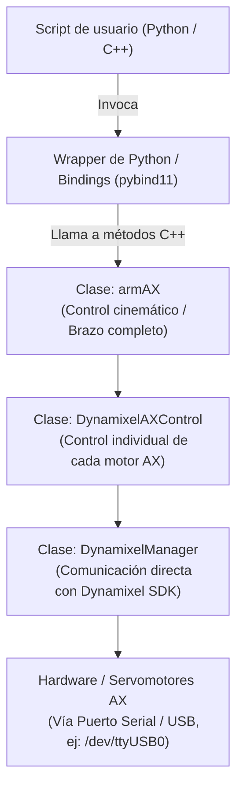

### 1. Arquitectura por Capas

La biblioteca abstrae el hardware en tres niveles clave:

* **Nivel de Comunicación (`DynamixelManager`):** : Controla el puerto serie a 1,000,000 baudios, gestionando paquetes de lectura/escritura en la EEPROM/RAM de los servomotores.

* **Nivel de Motor (`DynamixelAXControl`):** Gestiona actuadores individuales, permitiendo conmutar entre **Modo Articulación** (Joint Mode, 0°-300°) y **Modo Rueda** (Wheel Mode, rotación continua de 360°).

* **Nivel de Brazo Robótico (`armAX`):** Coordina múltiples servomotores de forma coordinada, aplicando cálculos para que todas las articulaciones alcancen sus posiciones objetivo simultáneamente en un tiempo determinado (movimiento síncrono).

