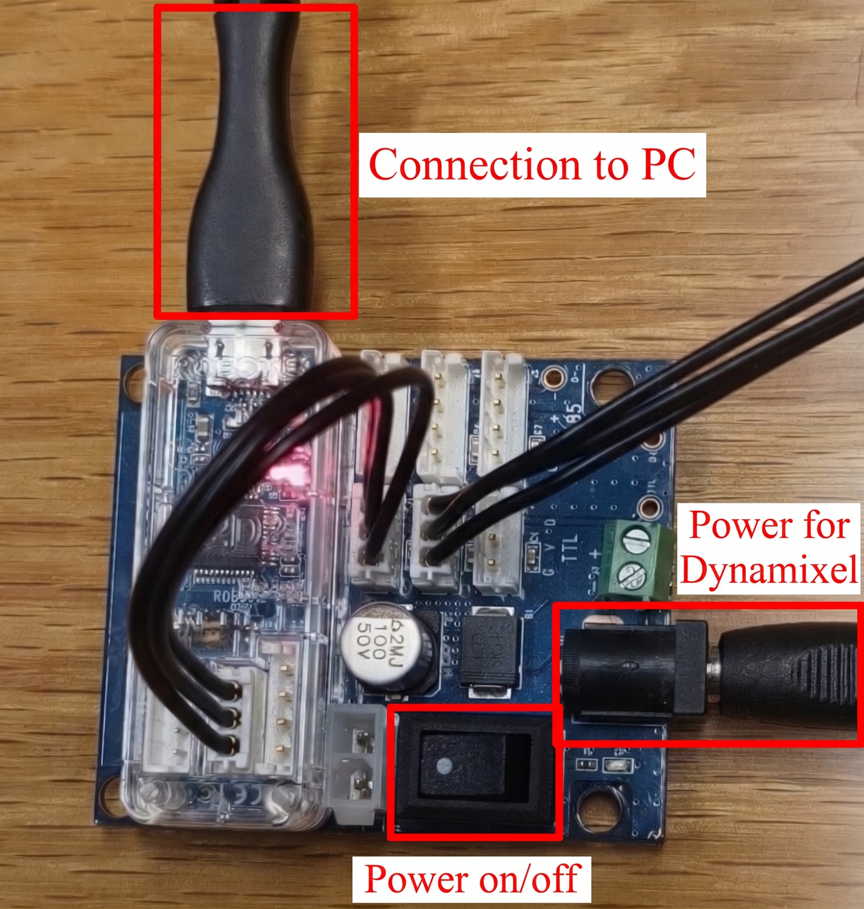

Esta sección proporciona instrucciones acerca del como configurar el hardware y el entorno del dispositivo.

# Requisitos

*Esta Guía de Inicio Rápido explica cómo utilizar los servomotores DYNAMIXEL con una PC como controlador principal. En lugar de una PC, también se pueden utilizar controladores embebidos como OpenRB, OpenCR o Arduino.*

Para controlar la Serie AX de DYNAMIXEL desde una PC, se requiere: 

* Un convertidor como U2D2, USB2AX o un adaptador FTDI para transformar las señales USB a TTL.

Dado que la interfaz USB (como el U2D2) no suministra energía directa a los motores, también se requiere una placa de distribución de energía (U2D2 Power Hub Board o fuente externa) para alimentar los servomotores.

## Conexion del motor 

**Importante** : *Asegúrate de utilizar una fuente de alimentación (SMPS) que coincida con el voltaje de operación del modelo específico que estás utilizando:   12V para toda la Serie AX (modelos AX-12A, AX-12+, AX-12W, AX-18A y AX-18F).*

## Identificación de componentes en la tarjeta

### Descripción de conexiones:
* **Connection to PC:** Cable USB conectado al módulo de comunicación U2D2 para el envío de comandos desde la computadora.
* **Power for Dynamixel:** Entrada de corriente DC (conector Jack de barril) para alimentar los motores.
* **Power on/off:** Interruptor principal para encender o apagar la alimentación del circuito.

### Pasos 

1. Conecta la placa de distribución de energía (Power Hub Board) a tu fuente de alimentación de 12V.

2. Conecta el adaptador USB (U2D2/USB2AX) a tu PC y a la placa de distribución.

3. Conecta los servomotores DYNAMIXEL. Puedes encadenar múltiples motores en configuración Daisy-Chain (un motor conectado al siguiente en serie).

**INFORMACIÓN**: Debes conectar el motor al puerto correspondiente según el tipo de comunicación que soporte tu DYNAMIXEL.

| DYNAMIXEL |
|:----------:|
| servoTTL: Los servomotores DYNAMIXEL basados en TTL (como toda la Serie AX) utilizan conectores de 3 pines. |
| RS-485: Los servomotores DYNAMIXEL basados en RS-485 utilizan conectores de 4 pines. |   

## Verificación de la conexióń 

Una vez completadas las configuraciones anteriores, puedes utilizar la herramienta DYNAMIXEL Wizard 2.0 para verificar que la comunicación y la alimentación funcionen correctamente.

## ¡PELIGRO: NO OMITAS ESTE PASO!

Este proceso es esencial para verificar y configurar la ID individual de cada motor y la velocidad de baudios (Baud Rate a 1,000,000 bps) antes de ejecutar cualquier script en el brazo robótico.

1. Instalar DYNAMIXEL Wizard 2.0: Descarga e instala la herramienta oficial desde el sitio de ROBOTIS.

2. Escanear y Operar los Motores: Realiza un escaneo de puertos (utilizando Protocolo 1.0 y 1,000,000 bps) para detectar los motores conectados. 

3. Verificar y Asignar ID: Asegúrate de que cada servomotor del brazo tenga una ID única asignada (por ejemplo: ID 1, ID 2, ID 3, etc.).   

4. Actualizar Firmware: Si el firmware de algún motor está desactualizado o presenta errores, realiza la actualización desde la misma herramienta.